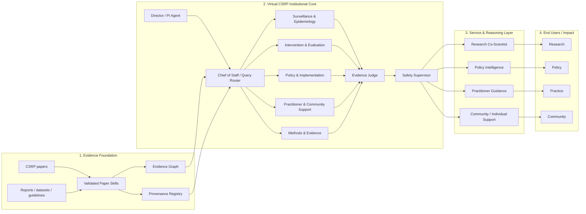
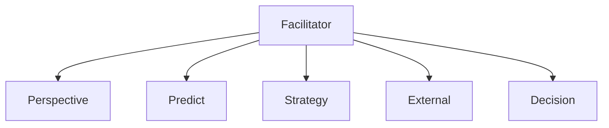
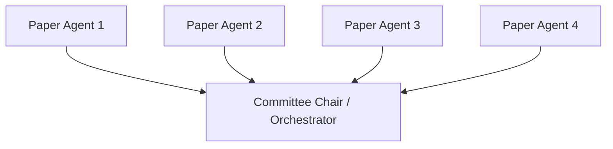
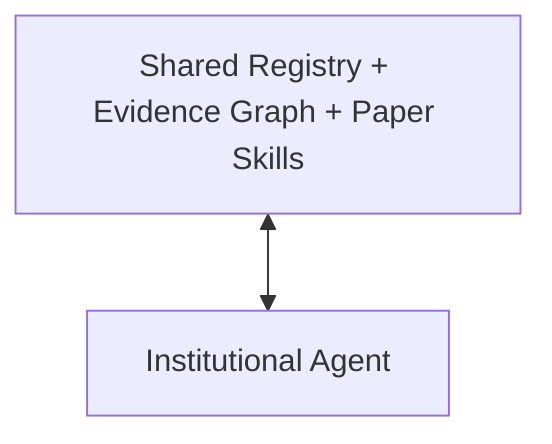

# v0.8 — Virtual CSRP

## Project framing

**Virtual CSRP** is an institutional AI architecture for suicide-prevention research, policy, practice and bounded community support.

The design is inspired by the organizational idea behind **Virtual Biotech**—a coordinating executive layer above specialized scientific divisions—but adapts the concept to an evidence-intensive public-health research institution.

The key extension is that Virtual CSRP treats the institution itself as the unit of agentification:

> **Paper2Agent agentifies a paper. Virtual CSRP agentifies an institution.**

Papers remain structured evidence/capability objects where appropriate; persistent agency is allocated at the organizational level.

## Complete architecture

## Five institutional divisions

### Surveillance & Epidemiology Unit
Responsible for trends, population patterns, risk factors, surveillance and spatial/temporal evidence.

### Intervention & Evaluation Unit
Responsible for intervention evidence, programme evaluation, effectiveness, implementation and follow-up.

### Policy & Implementation Unit
Responsible for policy synthesis, evidence-to-action translation, implementation constraints and resource-allocation reasoning.

### Practitioner & Community Support Unit
Responsible for practice-facing evidence, community resources, implementation questions and human-centred translation.

### Methods & Evidence Unit
Responsible for methods, study design, causal language, provenance, evidence synthesis, heterogeneity and uncertainty.

## Cross-cutting governance

Two roles sit across the institutional divisions:

- **Evidence Judge** — checks evidence quality, consistency, uncertainty, comparability and provenance.
- **Safety Supervisor** — enforces safety boundaries, abstention, bounded individual-facing use and human escalation.

These roles should not be interpreted as autonomous clinical authorities.

## Three organizational designs inside Virtual CSRP

Virtual CSRP is the **institutional shell**. The A/B/C architectures are alternative organizational forms tested inside that shell.

### A. Functional Virtual Institute

**Management interpretation:** functional differentiation and organizational information processing.

### B. Paper-Agent Committee

**Management interpretation:** expert committee, transactive memory, information aggregation and coordination cost.

### C. Shared-Knowledge Umbrella

**Management interpretation:** shared organizational memory, knowledge-based view and modular organization.

## Experimental separation

The institutional framing must not compromise experimental fairness.

For matched A/B/C tests, keep constant:

- corpus;
- retriever;
- EvidencePacket;
- evidence budget;
- base LLM/model version;
- total token ceiling;
- benchmark questions;
- safety rules where applicable.

Only the organizational coordination structure should vary.

## Central research question

> **How does organizational design shape collective reasoning, evidence integration and decision quality in AI co-scientists?**

Candidate moderators remain:

- task interdependence;
- task uncertainty;
- evidence load;
- evidence heterogeneity.

## Relationship to the current Means Restriction pilot

The four-paper Means Restriction pilot remains the first small experimental substrate. v0.8 does **not** replace that pilot or alter its questions. It adds the Virtual CSRP institutional layer above the existing A/B/C implementations.

## Safety boundary

Virtual CSRP is a research prototype. Community-facing outputs are limited to evidence-grounded information and signposting with human oversight. The system must not autonomously perform individual suicide-risk scoring, diagnosis, triage or treatment selection.
