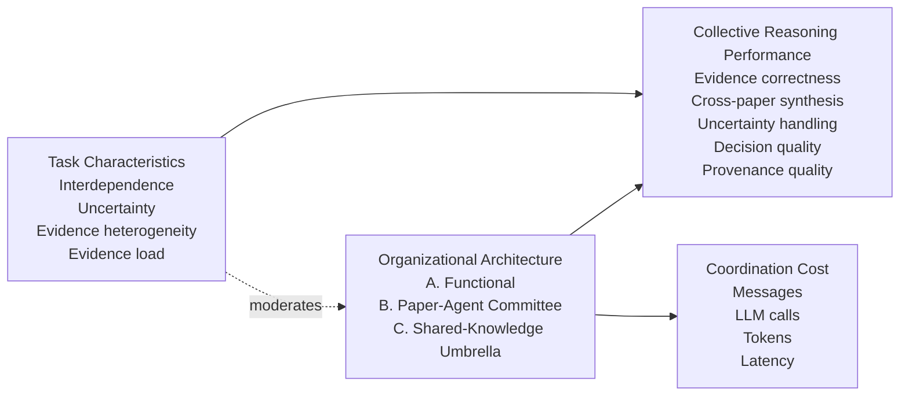

# Virtual CSRP Organizational Theory v1

## Research question

> **How does organizational design shape collective reasoning, evidence integration, and decision quality in AI co-scientists for suicide-prevention evidence synthesis?**

The theoretical unit is not the individual prompt or paper. It is the **AI organization**.

The same evidence base can be organized in different ways, and those organizational forms create different information-processing structures, coordination costs, memory boundaries and opportunities for cross-paper synthesis.

## Primary theoretical lens: Organizational Information Processing Theory

Organizational Information Processing Theory (OIPT) proposes that organizations face information-processing requirements created by uncertainty and interdependence. Structures differ in how much information they can process, where information is located and how coordination occurs.

For Virtual CSRP, the mapping is:

```text
Task demands
  ├── interdependence
  ├── uncertainty
  ├── evidence heterogeneity
  └── evidence load
          ↓
Information-processing requirements
          ↓
Organizational architecture
  ├── Functional Virtual Institute
  ├── Paper-Agent Committee
  └── Shared-Knowledge Umbrella
          ↓
Collective reasoning outcomes
  ├── evidence correctness
  ├── cross-paper synthesis
  ├── uncertainty handling
  ├── decision quality
  └── coordination cost
```

## Complementary theoretical lenses

### Contingency Theory

There is no assumption that one architecture is universally optimal. Performance should depend on **fit between organizational structure and task characteristics**.

### Transactive Memory Systems

The Paper-Agent Committee creates explicit knowledge specialization: each PaperAgent knows one paper and the Chair must know **who knows what**. This architecture may preserve heterogeneous viewpoints but introduces coordination overhead.

### Knowledge-Based View

The Shared-Knowledge Umbrella treats Paper Skills and the Evidence Graph as shared organizational memory. Knowledge is accessible across the institutional reasoning layer instead of being locked in paper-specific agents.

## Conceptual model



## Pre-pilot hypotheses

### H1 — Architecture–task fit

**The effect of AI organizational architecture on reasoning performance will depend on task information-processing demands; no architecture is expected to dominate across all task types.**

This is the umbrella contingency hypothesis.

### H2 — Functional specialization on decomposable tasks

**On decomposable tasks with low cross-paper interdependence, the Functional Virtual Institute will achieve comparable or higher decision quality with lower coordination burden than the Paper-Agent Committee.**

Rationale: role specialization should be efficient when the task can be divided cleanly into perspective, prediction, strategy, external-context and decision components.

### H3 — Committee deliberation under heterogeneous evidence

**When evidence is heterogeneous or potentially conflicting, the Paper-Agent Committee will surface a broader range of paper-specific viewpoints and disagreements than the Functional Virtual Institute, but its coordination cost will increase more rapidly with evidence load.**

Rationale: isolated paper expertise can preserve local evidence boundaries, but explicit aggregation becomes expensive as the number of paper agents increases.

### H4 — Shared knowledge on high-interdependence synthesis

**On highly interdependent cross-paper synthesis tasks, the Shared-Knowledge Umbrella will preserve cross-paper evidence links and provenance with lower coordination burden than the Paper-Agent Committee.**

Rationale: a shared evidence workspace removes repeated inter-agent transfer when the same reasoning step needs multiple papers simultaneously.

### H5 — Interaction between organizational form and task demand

**The performance advantage of a given architecture will be strongest when its coordination structure matches the task's interdependence and uncertainty, producing an architecture-by-task-characteristics interaction in decision quality and evidence integration.**

This is the main theory-testing prediction for an expanded benchmark.

## Pilot interpretation

The first 36-cell mini-pilot is **mechanism-seeking and diagnostic**, not confirmatory. With six questions and two replicates per architecture, it is too small for strong statistical inference.

The mini-pilot should tell us:

- whether the architectures actually behave differently;
- whether prompts and retrieval are fair;
- whether the chosen outcomes can discriminate useful differences;
- whether the hypotheses are operationalizable;
- which failure modes require correction before the larger benchmark.

Null or reversed patterns should be preserved and reported rather than tuned away.
