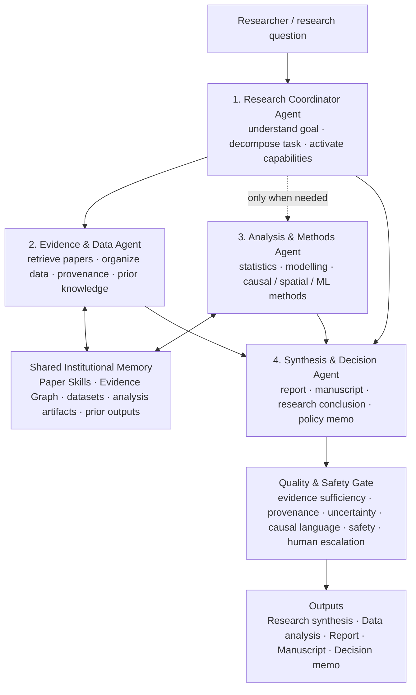

# v1.1 — Minimal Virtual CSRP

## Design correction

The earlier Virtual CSRP architecture deliberately mirrored a human research institute with a Director / PI Agent, Chief of Staff / Query Router and five organizational units.

For an AI-native research center, that is unnecessarily literal.

A human organization needs titles, reporting lines and administrative coordination because people have bounded attention, employment roles and communication constraints. An AI system should only create an autonomous agent when that role performs a **distinct information-processing function**.

The revised design therefore removes ceremonial organizational roles and reduces Virtual CSRP to the smallest useful set of cognitive functions.

## Minimal architecture



## Four core agent capabilities

### 1. Research Coordinator Agent

The Coordinator is the only orchestration role.

It replaces the earlier **Director + Chief of Staff** hierarchy.

Responsibilities:

- interpret the research goal;
- decompose the task;
- decide which capabilities are needed;
- select the output mode;
- sequence work;
- avoid activating unnecessary agents.

It should not duplicate evidence retrieval or statistical analysis.

### 2. Evidence & Data Agent

This role manages the center's accumulated knowledge and available data.

Responsibilities:

- retrieve CSRP Paper Skills;
- query the Evidence Graph;
- find relevant prior work;
- organize datasets and research artifacts;
- preserve provenance;
- identify evidence and data gaps.

The key question it answers is:

> **What do we already know, and what data do we have?**

### 3. Analysis & Methods Agent

This agent is activated **only when the task needs analysis**.

Responsibilities:

- data cleaning and transformation;
- statistical analysis;
- causal inference;
- spatial / temporal analysis;
- ML / NLP;
- visualization;
- sensitivity and robustness checks;
- method selection and reproducibility.

For literature-only questions, this agent can be skipped.

This is important: **four available agents does not mean four agents must run on every task.**

### 4. Synthesis & Decision Agent

This role converts evidence and analysis into the requested research product.

The same agent can use different output schemas:

```text
Research mode   → evidence synthesis / hypotheses / gaps
Report mode     → technical report
Manuscript mode → manuscript-ready research writing
Policy mode     → evidence memo / decision support
```

Separate "Report Agent", "Writing Agent" and "Decision Agent" roles are not necessary unless future evidence shows a benefit.

## What is deliberately NOT an agent

### Shared Institutional Memory

The following are infrastructure, not autonomous personas:

- Paper Skills;
- Evidence Graph;
- provenance registry;
- datasets;
- analysis artifacts;
- prior research outputs.

Memory should be callable and shared.

### Quality & Safety Gate

Evidence checking and suicide-prevention safety are cross-cutting validation functions.

They should initially be implemented as a gate rather than two additional conversational agents.

Checks include:

- evidence sufficiency;
- citation/provenance validity;
- causal-language discipline;
- uncertainty and transferability;
- unsupported claims;
- individual-risk safety;
- human escalation.

## Research workflow

The center is now best understood as:

> **Coordinate → Retrieve → Analyze when necessary → Synthesize → Validate**

rather than as a simulated staff hierarchy.

## Minimum active organization

For a literature synthesis task:

```text
Coordinator
   ↓
Evidence & Data
   ↓
Synthesis & Decision
   ↓
Quality & Safety Gate
```

Only **3 agents** are active.

For a data-analysis task:

```text
Coordinator
   ↓
Evidence & Data
   ↓
Analysis & Methods
   ↓
Synthesis & Decision
   ↓
Quality & Safety Gate
```

All **4 agents** are active.

This gives us a useful future empirical question:

> **What is the minimum organizational complexity required for effective institutional intelligence?**

That question should be tested later as an agent-count / role-ablation study rather than assumed in advance.

## Relationship to A/B/C experiments

The minimal Virtual CSRP is the **recommended operating architecture**.

The A/B/C architectures remain separate experimental treatments for the organizational-design study:

- A — Functional Virtual Institute;
- B — Paper-Agent Committee;
- C — Shared-Knowledge Umbrella.

They should not be silently rewritten after a benchmark is frozen.

This separation is important:

> **Production architecture asks: what should we build?**  
> **A/B/C experiment asks: what organizational design works under which task conditions?**

## Suicide-prevention focus

At this stage, Virtual CSRP remains a suicide-prevention research system.

Its near-term capabilities are:

1. organize accumulated suicide-prevention evidence;
2. identify and prepare relevant data;
3. conduct or specify analysis;
4. produce research reports and manuscript material;
5. provide population-level policy/research decision support;
6. reuse institutional knowledge with claim-level provenance.

It is not an autonomous clinical decision system and must not perform individual suicide-risk scoring, diagnosis, triage or treatment selection.
